# 데일리 알고리즘 스터디

**바로가기 — [📋 참여 안내(온보딩)](docs/ONBOARDING.md) · [🚀 시작하기](#1-준비물-docker) · [📅 출석표](#출석표)**

매일 **lv0 ~ lv3 네 문제**(프로그래머스 난이도 기준, Java 21)를 풀고 **버튼 하나로 PR 제출**하는 스터디입니다.

> 출제 기준은 [CLAUDE.md](CLAUDE.md), 문제 목록은 [problems/INDEX.md](problems/INDEX.md) 에 있습니다.

---

## 1. 준비물: Docker

| OS | 설치 |
|---|---|
| macOS | <https://www.docker.com/products/docker-desktop/> → Docker Desktop (Apple Silicon / Intel 에 맞게) |
| Windows | 같은 페이지 → Docker Desktop. 설치 중 **WSL 2** 를 켜라고 하면 켭니다 (재부팅 필요할 수 있음) |

설치 후 Docker Desktop 을 실행해 두고(메뉴 막대/트레이에 고래 아이콘), 터미널(macOS: 터미널, Windows: PowerShell)에서 확인합니다.

```bash
docker compose version
```

`Docker Compose version v2.x` 처럼 나오면 됩니다.

## 2. 레포 받기

호스트가 보낸 조직 초대 메일(또는 <https://github.com/15th-algo-study>)에서 **Join** 을 먼저 누르세요. 레포는 public 이라 누구나 볼 수 있지만, **제출(PR)** 은 조직 멤버만 할 수 있습니다.

폴더 경로에 **한글·공백이 없는 곳**(예: `~/study`, `C:\study`)을 권장합니다.

**방법 A — git 이 있다면**
```bash
git clone https://github.com/15th-algo-study/study.git
cd study
```

**방법 B — git 이 없다면 (ZIP)**
1. <https://github.com/15th-algo-study/study> → 초록색 **Code** 버튼 → **Download ZIP**
2. 압축을 풀고 폴더 이름을 `study` 로 바꾼 뒤 터미널에서 그 폴더로 이동합니다.
3. 앱을 켜고 로그인한 다음(3·4단계) 화면 위의 **GitHub 저장소와 연결** 버튼을 누릅니다 (5단계).

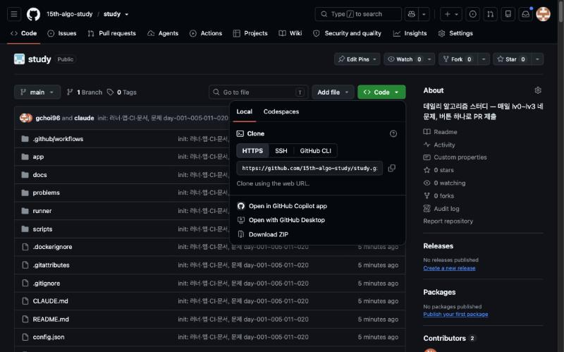

## 3. 앱 실행

레포 폴더에서:

```bash
docker compose up --build
```

- 첫 실행은 이미지를 만드느라 **몇 분** 걸립니다 (JDK·Node·Gradle 을 내려받습니다). 두 번째부터는 몇 초입니다.
- `--build` 는 항상 붙이세요. 호스트가 앱을 고치면 자동으로 반영됩니다.
- 아래처럼 뜨면 브라우저에서 **<http://localhost:15015>** 를 엽니다.

```
algo-study-app  | 알고리즘 스터디 앱: http://localhost:15015
algo-study-app  |   레포      : /workspace
algo-study-app  |   데이터    : /data
```

- 끄려면 터미널에서 `Ctrl+C`. 로그인 정보와 작성 중인 코드는 Docker 볼륨에 남아 다시 켜도 그대로입니다.

> 💻 **로컬에서 Docker 실행이 어렵다면** 호스트가 운영하는 서버 주소(Slack 공지)로 접속해 4단계부터 진행하면 됩니다. 설치가 필요 없고 사용법은 같습니다.

**포트가 이미 사용 중이라고 나오면** `docker-compose.yml` 에서 `"15015:15015"` 의 **왼쪽 숫자만** 바꾸고(예: `"15016:15015"`) 다시 실행한 뒤 <http://localhost:15016> 으로 접속합니다.

처음 열면 이렇게 보입니다. 로그인 전에도 문제는 볼 수 있지만 **제출**은 로그인이 필요합니다.

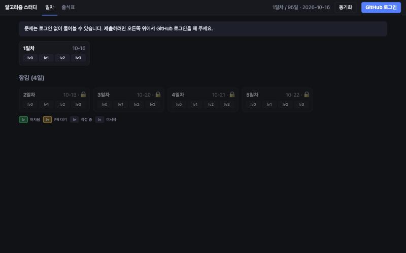

## 4. GitHub 로그인

오른쪽 위 **GitHub 로그인** 을 누르면 8자리 코드가 나옵니다.

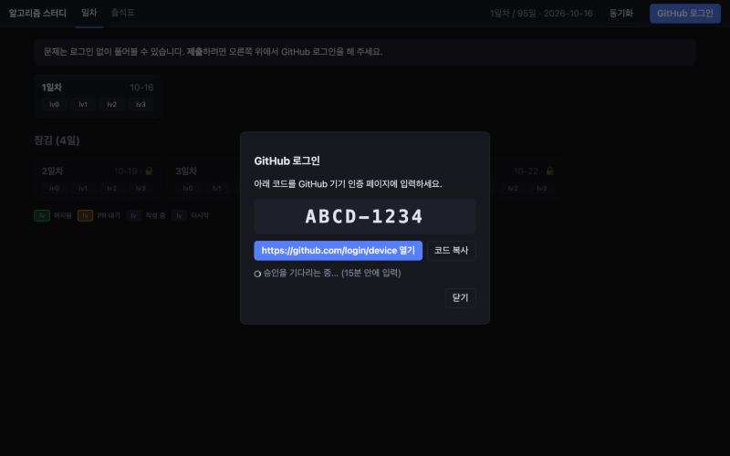

1. **https://github.com/login/device 열기** 버튼을 누릅니다 (새 탭). GitHub 에 로그인되어 있지 않으면 먼저 로그인합니다.
2. 아래 화면에 8자리 코드를 입력하고 **Continue** 를 누릅니다.

   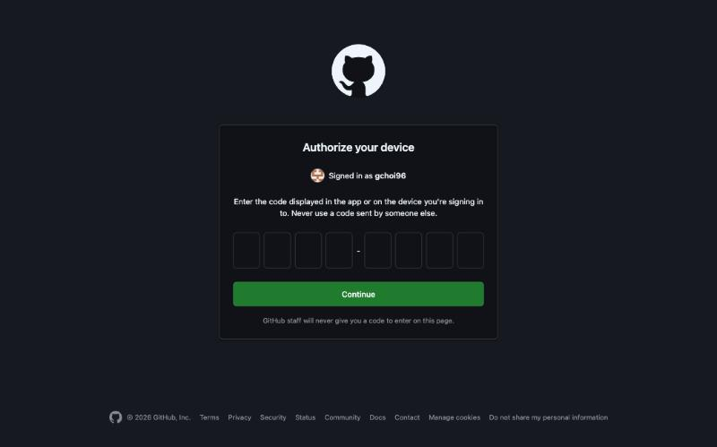

3. 다음 화면에서 **Authorize** 를 누릅니다. 스터디용 GitHub App 에 "내 계정으로 이 레포에 PR 을 만들 권한"을 주는 것이며, 이 레포 하나에만 적용됩니다.
4. 앱 탭으로 돌아오면 자동으로 로그인되어 오른쪽 위에 내 아이디가 뜹니다. 한 번 하면 계속 유지됩니다.

> 📷 **직접 캡처 필요** — **Authorize** 화면. GitHub App 을 만든 뒤 첫 로그인 때 캡처해 `docs/images/gh-authorize.png` 로 저장하고 아래 주석을 풀어 주세요.
> <!--  -->

## 5. (ZIP 으로 받은 경우) 저장소와 연결

ZIP 으로 받았다면 로그인 후 화면 위에 노란 안내와 **GitHub 저장소와 연결** 버튼이 보입니다. 한 번 누르면 이 폴더가 git 저장소로 바뀌어 제출·동기화가 됩니다. (git clone 으로 받았다면 이 안내가 나오지 않습니다.)

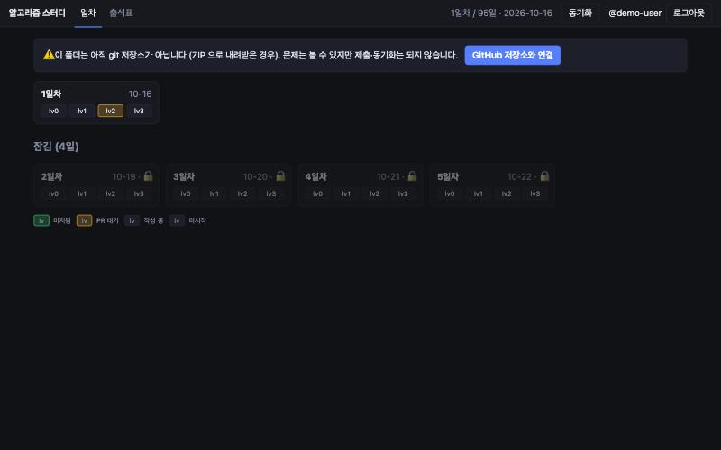

## 6. 일차 목록

로그인하면 일차 카드가 보입니다. 오늘까지 열린 일차만 누를 수 있고, 앞으로 열릴 일차는 🔒 로 흐리게 표시됩니다 (매일 하나씩 열립니다).

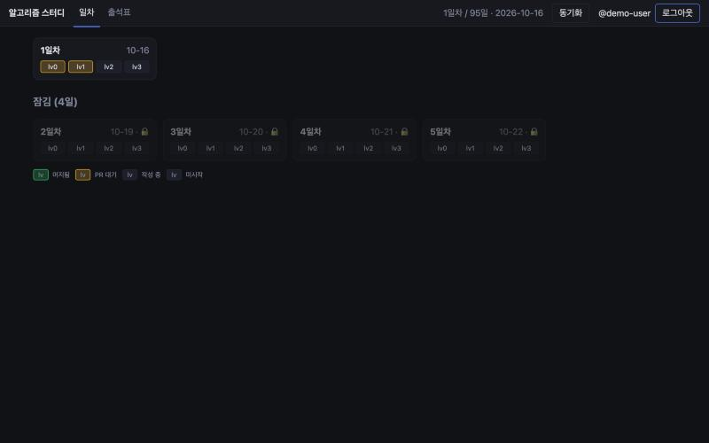

카드 안의 `lv0`~`lv3` 색은 내 상태입니다.

| 표시 | 뜻 |
|---|---|
| 초록 | **머지됨** — PR 이 머지되어 출석표에 반영됨 |
| 노랑 | **PR 대기** — 제출은 했고 CI 채점·머지를 기다리는 중 |
| 점선 | **작성 중** — 코드를 쓰다 말았음 (자동 저장됨) |
| 기본 | 미시작 |

## 7. 문제 풀기

카드를 누르면 문제 화면입니다. 위쪽 `lv0 lv1 lv2 lv3` 탭으로 같은 날 다른 문제로 이동합니다.

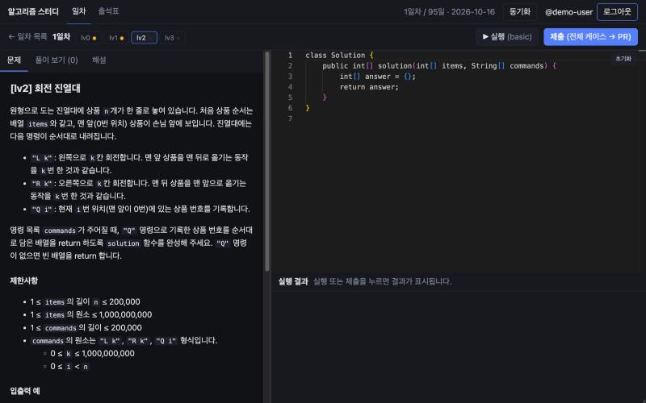

- **왼쪽**: 문제 · 풀이 보기 · 해설 탭
- **오른쪽**: 코드 편집기. `class Solution` 의 `solution` 메서드를 채웁니다. **자동 저장**되므로 창을 닫아도 이어서 쓸 수 있습니다. **초기화** 는 템플릿으로 되돌립니다.
- **아래**: 실행 결과

### ▶ 실행 (basic)

지문의 예시와 몇 가지 엣지 케이스만 빠르게 돌립니다. 틀린 케이스는 **입력 · 기대값 · 실제값**(런타임 오류면 예외와 줄 번호)이 바로 보입니다.

디버깅용으로 `System.out.println` / `System.err.println` 으로 찍은 내용은 케이스마다 **콘솔 출력** 칸에 함께 보입니다 (케이스당 32KB 까지). 제출할 때는 출력을 보여 주지 않으니, 지우지 않고 제출해도 됩니다 — 다만 큰 입력에서 많이 찍으면 그만큼 느려져 시간 초과가 날 수 있습니다.

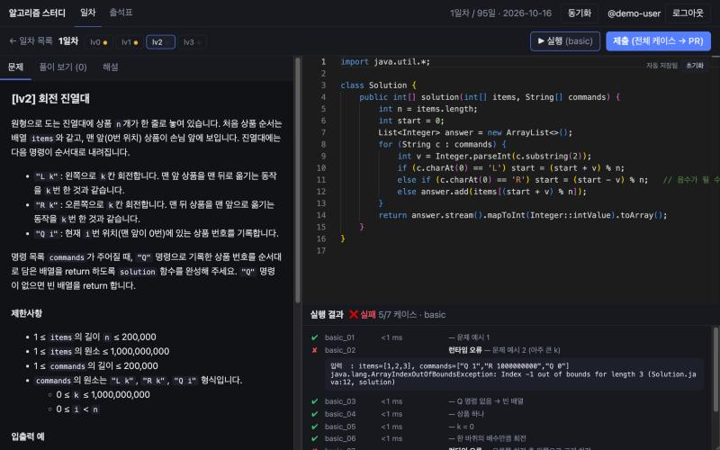

### 제출 (전체 케이스 → PR)

큰 입력(시간 제한 포함)까지 전부 채점합니다. **모두 통과하면** 앱이 알아서

1. `solutions/<내 아이디>/day-001/lv2/Solution.java` 에 저장하고
2. 내 계정 이름으로 커밋해 `user/<내 아이디>` 브랜치에 올리고
3. `main` 으로 **PR 을 만듭니다.**

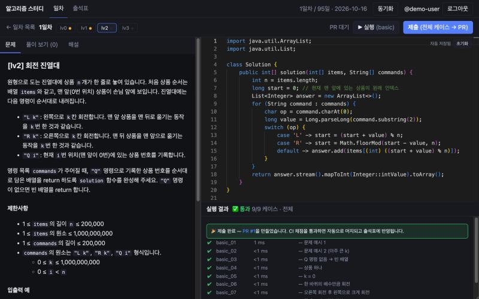

PR 은 GitHub Actions 가 한 번 더 채점하고, 통과하면 **1~2분 안에 자동으로 머지**됩니다. 머지되면 출석표에 내 행이 생깁니다 — **첫 PR 이 머지되는 순간 자동 등록**이고, 그날이 내 합류일입니다. 같은 날 다른 레벨을 이어서 제출하면 열려 있는 PR 에 함께 들어갑니다.

> 📷 **직접 캡처 필요** — 실제 PR 페이지의 **grade 채점 코멘트(✅)와 자동 머지된 모습**. 첫 제출 후 캡처해 `docs/images/gh-pr-merged.png` 로 저장하고 아래 주석을 풀어 주세요.
> <!--  -->

하나라도 실패하면 PR 은 만들어지지 않고 실패한 케이스가 표시됩니다. `large_*` 에서 **시간 초과**라면 더 효율적인 방법이 필요하다는 뜻입니다. (로컬에서는 제한 시간을 2배로 봐 주고, CI 는 정확히 봅니다.)

## 8. 풀이 보기 · 해설

언제든 볼 수 있습니다. 막히면 먼저 30분은 스스로, 그다음 해설을 보고 **직접 다시 짜서** 제출하는 것을 권합니다.

**풀이 보기** — 이 문제를 푼(머지된) 사람 목록과 코드. 상단 **동기화** 를 누르면 최신 풀이를 받아옵니다.

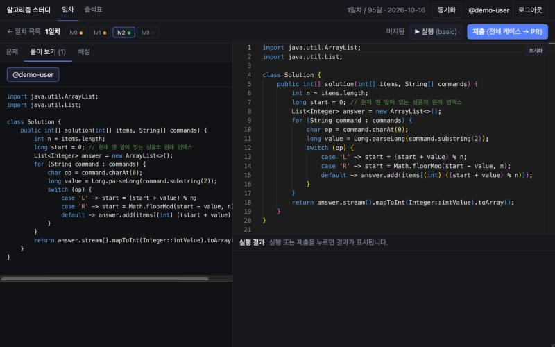

**해설** — 접근 · 주의할 점 · 복잡도 · 모범 풀이.

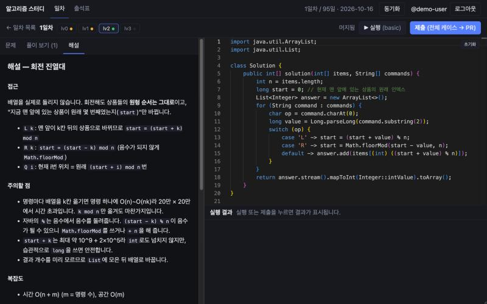

## 9. 출석표

상단 **출석표** 탭. 머지된 풀이 기준이며, 같은 내용이 이 README 맨 아래에도 자동으로 갱신됩니다.

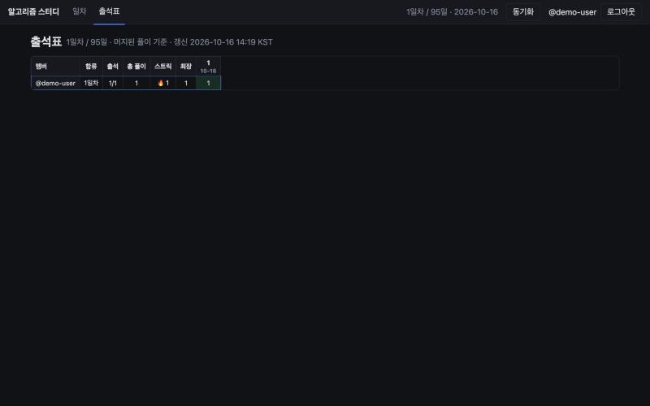

- 칸의 숫자 = 그날 푼 문제 수(최대 4), `·` = 안 품, `-` = 합류 전
- 출석 = 합류 후 열린 날 중 1문제 이상 푼 날 / 열린 날
- 스트릭 = 연속 출석일 (오늘 아직 안 풀었으면 어제까지로 셉니다)

## 10. 잔디(Contribution)

레포가 public 이고 커밋 작성자가 내 계정의 noreply 이메일(`<id>+<아이디>@users.noreply.github.com`)이라, 머지된 풀이는 별도 설정 없이 프로필 잔디에 집계됩니다. 잔디가 안 보이면 GitHub 계정 Settings → Emails 에 그 noreply 주소가 연결되어 있는지(기본으로 되어 있음) 확인하세요.

## 11. 문제가 생기면

| 증상 | 해결 |
|---|---|
| `port is already allocated` / 포트 사용 중 | 3단계의 포트 변경 |
| (Windows) `the path "C:\\Users\\…" is not shared from the host` | Docker Desktop → Settings → General → **Use the WSL 2 based engine** 켜기(권장). 또는 Settings → Resources → File Sharing 에 `C:\` 추가. 폴더는 `C:\study` 처럼 **한글·공백 없는 경로**로 옮기는 것을 권장 |
| `GitHub 로그인` 을 눌러도 코드가 안 나옴 | 호스트가 `config.json` 의 `github_app_client_id` 를 아직 안 채운 것. 호스트에게 문의 |
| 코드가 만료됨 | 닫고 다시 **GitHub 로그인** |
| "레포 루트가 git 저장소가 아닙니다" | ZIP 으로 받은 경우. 로그인 후 **GitHub 저장소와 연결** (5단계) |
| PR 은 생겼는데 CI 가 ❌ | PR 페이지 코멘트에 이유가 있음. 로컬보다 느린 CI 에서 시간 초과이거나 다른 파일을 건드린 경우. 고쳐서 다시 **제출**하면 같은 PR 이 갱신됨 |
| 새 문제·남의 풀이가 안 보임 | 상단 **동기화** |
| 동기화가 "작업 트리를 갱신하지 못했습니다" | 레포 폴더 안의 파일을 직접 고친 경우. 되돌리거나 호스트에게 문의 |
| 하루를 놓침 | 지난 일차도 언제든 풀어 제출할 수 있음. 출석표의 그 일차 칸에 표시됨 |
| 앱을 완전히 지우고 싶음 | 레포 폴더에서 `docker compose down -v` (로그인·작성 중 코드까지 삭제) |
| Linux 에서 파일이 root 소유로 생김 | `docker-compose.yml` 의 `app:` 아래에 `user: "1000:1000"` (본인 `id -u`:`id -g`) 추가 |

IntelliJ 등 다른 편집기를 쓰고 싶으면 `problems/day-NNN/lv<N>/Solution.java` 를 열어 풀고, 앱 편집기에 붙여 넣어 제출하면 됩니다. 앱 편집기 내용이 기준입니다.

## 12. 규칙

- 제출 파일은 `solutions/<내 아이디>/` 아래만. 다른 경로를 건드린 PR 은 CI 가 거절합니다.
- 시간 제한: lv0·lv1 1초, lv2 2초, lv3 3초 (CI 기준. 로컬 제출은 2배 여유).
- 해설·남의 풀이를 봐도 됩니다. 보고 나서 **직접 다시 짜서** 제출하세요.
- **레포는 public 입니다.** 제출한 풀이는 누구나 볼 수 있고 `https://github.com/15th-algo-study/study/tree/main/solutions/<아이디>` 가 그대로 포트폴리오 링크가 됩니다. 코드에 개인 정보나 회사 코드를 넣지 마세요. 본인 풀이를 내리고 싶으면 호스트에게 말해 주세요(폴더 삭제 PR).

## 폴더 구조

| 경로 | 내용 |
|---|---|
| `problems/day-NNN/lv<N>/` | 문제(README), 템플릿, 케이스, 해설 |
| `solutions/<login>/day-NNN/lv<N>/Solution.java` | 멤버 풀이 (앱이 PR 로 올림) |
| `app/` | 로컬 앱 (Express + Monaco) — [app/README.md](app/README.md) |
| `runner/` | 채점기 (Gradle + JUnit 5) |
| `scripts/` | 문제 검증 · 출석표 · 초대 · 출제 보조 · 자동 머지 판정 |
| `docs/` | [ONBOARDING](docs/ONBOARDING.md) · [PROJECT_INSTRUCTIONS](docs/PROJECT_INSTRUCTIONS.md)(claude.ai 조교 지침) |
| `.github/workflows/` | `grade.yml`(PR 채점), `merge.yml`(채점 통과 PR 재확인 후 자동 머지), `attendance.yml`(출석표 갱신) |

## 출석표

<!-- attendance:start -->
**11일차 / 150일** · 2026-10-28 · 갱신: 2026-10-28 16:50 KST

| 멤버 | 합류 | 출석 | 총 풀이 | 스트릭 | 최장 | 2<br>10-19 | 3<br>10-20 | 4<br>10-21 | 5<br>10-22 | 6<br>10-23 | 7<br>10-24 | 8<br>10-25 | 9<br>10-26 | 10<br>10-27 | 11<br>10-28 |
|---|---|---|---|---|---|---|---|---|---|---|---|---|---|---|---|
| @rojuncha | 1일차 | 6/11 | 10 | 0 | 6 | 2 | 1 | 2 | 1 | 2 | · | · | · | · | · |
| @gchoi96 | 1일차 | 5/11 | 8 | 🔥 1 | 4 | 2 | 2 | 1 | · | · | · | · | · | · | 1 |
| @HappyDays0921 | 1일차 | 2/11 | 3 | 0 | 2 | 1 | · | · | · | · | · | · | · | · | · |

출석 = 합류 이후 해금된 일차 중 1문제 이상 푼 날 · 칸의 숫자 = 그날 푼 문제 수(최대 4) · `-` = 합류 전 · 스트릭은 연속 출석일(휴일 제외)
<!-- attendance:end -->
